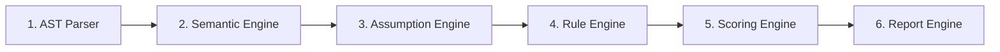

# Sentinel — Production Readiness Intelligence Engine

[](https://www.typescriptlang.org/)
[](https://pnpm.io/)
[](LICENSE)

> **Beyond Code Coverage:** Detect hidden developer assumptions, unhandled failure modes, stale closures, event loop bottlenecks, and production risks *before* they break in production.

---

## 💡 Why Sentinel?

Traditional static analysis and testing tools rely on **best-case code execution** or **code coverage metrics**. Passing code coverage thresholds (e.g. 80% or 90%) only proves that a line of code was executed under ideal mock conditions—it does **not** prove that the code will survive real-world production conditions like network drops, stale closures, missing null guards, hardcoded secrets, or event loop blocking.

**Sentinel** shifts the paradigm to **Production Readiness Intelligence**:
1. **Parses AST Evidence:** Scans source code for structural patterns across React, Node.js, JavaScript, and TypeScript.
2. **Derives Semantic Observations:** Identifies implicit engineering assumptions made by developers.
3. **Projects Production Risks:** Calculates a Production Readiness Score (0–100) and outputs exact lines of code, severities, and actionable remediation steps.

---

## 🏗️ Architecture & Pipeline Stages

Sentinel processes code through a 6-stage deterministic analysis pipeline:



| Stage | Component | Responsibility |
| :--- | :--- | :--- |
| **1. AST Parser** | `AstParserEngine` | Extracts raw code evidence, exact line numbers, and snippets from source files. |
| **2. Semantic Engine** | `SemanticEngine` | Transforms structural evidences into semantic runtime observations. |
| **3. Assumption Engine**| `AssumptionEngine` | Infers hidden developer assumptions (e.g., assuming network calls never fail). |
| **4. Rule Engine** | `RuleEngine` | Evaluates observations against production readiness rules & projects risks. |
| **5. Scoring Engine** | `ScoringEngine` | Deducts score penalty based on finding severities (`CRITICAL`: -30, `HIGH`: -20, `MEDIUM`: -10, `LOW`: -5). |
| **6. Report Engine** | `ReportEngine` | Generates actionable remediation recommendations and E2E verification test scenarios. |

---

## 🛡️ Supported Issue & Rule Taxonomy

Sentinel evaluates 15+ production rules across **React, Node.js, JavaScript, and TypeScript**:

### ⚛️ React & Frontend Rules

| Rule ID | Title | Severity | Description |
| :--- | :--- | :---: | :--- |
| `REACT_HOOK_DEPENDENCY_RULE` | **Stale Closure Hazard** | `HIGH` | Closure variables referenced inside `useEffect` or `useCallback` omitted from dependency array. |
| `REACT_LIST_KEY_REORDERING_RULE` | **State Corruption** | `MEDIUM` | Using array index (`key={index}`) as React component list key prop. |
| `IMMUTABLE_STATE_MUTATION_RULE` | **Unresponsive UI** | `HIGH` | Direct in-place mutation of state arrays (`.push`) or state object properties. |
| `UNHANDLED_ASYNC_EVENT_HANDLER_RULE` | **Stuck UI Buttons** | `HIGH` | Async `onClick`/`onSubmit` event handlers lacking `try/catch` or pending state resets. |
| `MEMORY_LEAK_EVENT_LISTENER_RULE` | **Browser OOM Leak** | `HIGH` | `window.addEventListener` or `.on()` registered without cleanup in `useEffect` return block. |

### 🟢 Node.js & Server Rules

| Rule ID | Title | Severity | Description |
| :--- | :--- | :---: | :--- |
| `NODE_EVENT_LOOP_BLOCKING_RULE` | **Event Loop Blocking** | `CRITICAL` | Using `fs.readFileSync`, `fs.writeFileSync`, or `execSync` inside server request handling paths. |
| `SILENT_ERROR_SWALLOWING_RULE` | **Bug Masking** | `HIGH` | Empty `catch (err) {}` or swallowing errors without logging or re-throwing. |
| `NETWORK_TIMEOUT_BOUNDARY_RULE` | **Cascading Outage** | `HIGH` | `fetch()` or `axios` network requests executed without explicit timeout or `AbortSignal` deadline. |
| `API_RATE_LIMITING_RULE` | **DoS Vulnerability** | `MEDIUM` | Express API route definitions (`app.get`, `app.post`) lacking rate-limiting middleware. |

### 🔒 Security & Defensive Coding Rules

| Rule ID | Title | Severity | Description |
| :--- | :--- | :---: | :--- |
| `HARDCODED_SECRET_SECURITY_RULE` | **Credential Leak** | `CRITICAL` | Hardcoded API keys, JWT secrets, passwords, or bearer tokens in source code. |
| `SQL_INJECTION_PREVENTION_RULE` | **Database Breach** | `CRITICAL` | Dynamic SQL query string concatenation (`SELECT ... + input`) exposing SQL Injection. |
| `NULL_SAFETY_RULE` | **White Screen Crash** | `CRITICAL` | Direct property access on uninitialized state objects without null guards or `?.`. |
| `UNSAFE_TYPE_ASSERTION_RULE` | **Type Bypass** | `MEDIUM` | Unsafe type assertions (`as any` / `as unknown as`) bypassing runtime validation. |
| `FLOATING_POINT_CURRENCY_PRECISION_RULE` | **IEEE 754 Rounding** | `HIGH` | Direct floating point arithmetic on financial currency fields (`price * 0.08`). |

---

## 🚀 Quick Start

### 1. Prerequisites
- **Node.js** v20.0.0+
- **pnpm** v9.0.0+

### 2. Installation
Clone the repository and install workspace dependencies:
```bash
git clone https://github.com/kamlesh-2403/sentinel.git
cd sentinel
pnpm install
```

---

## 💻 CLI Usage

### Scan a Specific Source File
```bash
pnpm scan examples/sample-app/UserProfile.tsx
```

### Scan an Entire Application Directory
```bash
# Scans all .ts, .tsx, .js, .jsx files in the target directory recursively
pnpm scan /path/to/your/existing-app
```

### Output Example
```text
===============================================================================
               SENTINEL — PRODUCTION READINESS INTELLIGENCE                    
===============================================================================
Scanning Target: examples/vulnerable/VulnerableApp.tsx (1 file(s) found)
Executing Reasoning Engine Pipeline...

-------------------------------------------------------------------------------
[FILE 1/1] examples/vulnerable/VulnerableApp.tsx
READINESS SCORE: [ 0 / 100 ]
FINDINGS & AFFECTED CODE LINES:
  1. [CRITICAL] Hardcoded Credential Security Leak
     Description  : Storing secrets directly in code exposes API keys and tokens in bundle artifacts and source control.
     Rule ID      : HARDCODED_SECRET_SECURITY_RULE
     Line Number  : Line 6
     Code Snippet : const apiKey = "api_key = 'secret_abc123456789'";

  2. [CRITICAL] Synchronous Event Loop Blocking Hazard
     Description  : Executing synchronous file system I/O freezes the Node.js event loop thread for all active requests.
     Rule ID      : NODE_EVENT_LOOP_BLOCKING_RULE
     Line Number  : Line 10
     Code Snippet : const configData = fs.readFileSync("/tmp/config.json", "utf-8");

===============================================================================
                       FINAL APPLICATION SUMMARY                               
===============================================================================
Target Path               : examples/vulnerable/VulnerableApp.tsx
Files Analyzed            : 1
Overall Readiness Score   : [ 0 / 100 ] — DANGEROUSLY LOW READINESS
Total Production Risks    : 6
Total Assumptions Tracked : 6
Total Rules Evaluated     : 15
===============================================================================
```

---

## 🛠️ Global CLI Setup

To run `sentinel` directly from any terminal prompt on your system:

```zsh
# Add alias to your shell profile (~/.zshrc or ~/.bashrc)
echo 'alias sentinel="pnpm --prefix /Users/kamleshthakre/Desktop/proj/sentinel/sentinel scan"' >> ~/.zshrc
source ~/.zshrc

# Now scan any project from anywhere:
cd /path/to/my-app
sentinel .
```

---

## 🔌 Programmatic Integration

You can integrate Sentinel directly into unit tests, build tools, or CI/CD pipelines:

```typescript
import { ReasoningEngine } from "@sentinel/engines";
import fs from "node:fs";

// 1. Initialize ReasoningEngine
const engine = new ReasoningEngine();

// 2. Read target source file
const filePath = "src/components/UserProfile.tsx";
const sourceCode = fs.readFileSync(filePath, "utf-8");

// 3. Run analysis
const report = engine.analyze({ filePath, sourceCode });

console.log(`Readiness Score: ${report.summary?.score}/100`);
console.log("Findings:", report.findings);
```

---

## 🧪 Running Tests

Execute the end-to-end verification test suite:
```bash
pnpm test
```

---

## 📜 License

Distributed under the MIT License. See [LICENSE](LICENSE) for details.